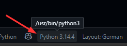
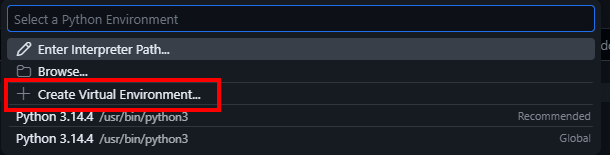
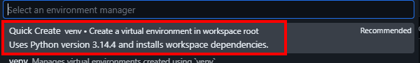

# S3VL03-MQTT

Übungen zu MQTT

## Vorbereitung
GitHub Codespace für `DHBW-VS-Vert-Sys/S3VL03-MQTT` erstellen.

- `docker-compose.yaml` untersuchen: Aufbau, Container, Startablauf und Subscriber-Topic.
- `mosquitto/mosquitto.conf` prüfen: Warum ist die Konfiguration für den Produktivbetrieb ungeeignet? Welche Alternativen gibt es? 

> Siehe auch https://mosquitto.org/man/mosquitto-conf-5.html

## Start
Alle Befehle im Hauptverzeichnis des aktuellen Projekts ausführen.

Subscriber starten:
```bash
docker compose run subscriber
```

Publisher in einem zweiten Terminal starten:
```bash
docker compose run publisher
```

Im Publisher-Terminal eine Nachricht senden:
```bash
mosquitto_pub -h mosquitto -t test/topic -m "Hallo MQTT"
```

## Experimente
- Zweiten Subscriber in einem weiteren Terminal starten.
- Topics ändern und einen Subscriber auf ein anderes Topic lauschen lassen.
- Wildcards `#` und `+` ausprobieren.
- Optional: Authentifizierung konfigurieren und testen.

## Python

### Vorbereitungen 
Eine virtuelle Python-Umgebung verwenden und die `paho-mqtt`-Bibliothek installieren:

1. Öffne `main.py` in VSCode (Codespaces)
2. Clicke am unteren rechten Bildschirmrand auf die Python-Version und wähle anschließend "Create Virtual Environment":





3. Wähle "Quick Create" um die virtuelle Umgebung zu erstellen und alle Abhängigkeiten zu installieren:



VSCode installiert `paho-mqtt` automatisch in der virtuellen Umgebung, da es in der `requirements.txt` aufgeführt ist.
Falls man das Paket manuell installieren müsste, kann man dies mit folgendem Befehl tun:

```bash
pip install paho-mqtt
```

### Aufgabe

Schreibe ein Python-Skript `main.py`, das:
- Nachrichten von einem bestimmten Topic empfängt (Subscriber)
- Optional: Nachrichten an ein Topic sendet (Publisher)

Verwende die `paho-mqtt`-Bibliothek, um die Verbindung zum MQTT-Broker herzustellen und Nachrichten zu verarbeiten. 
Nutze die [offizielle Dokumentation](https://www.hivemq.com/blog/mqtt-client-library-paho-python/) für weitere Informationen und Beispiele.