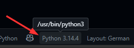
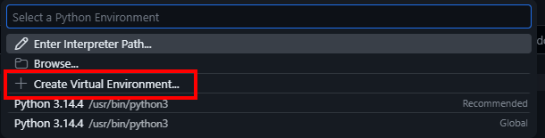
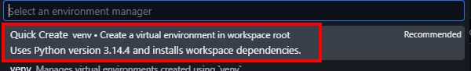

# S3VL03-MQTT

Übungen zu MQTT

## Vorbereitung
GitHub Codespace für `DHBW-VS-Vert-Sys/S3VL03-MQTT` erstellen.

- `docker-compose.yaml` untersuchen: Aufbau, Container, Startablauf und Subscriber-Topic.
- `mosquitto/mosquitto.conf` prüfen: Warum ist die Konfiguration für den Produktivbetrieb ungeeignet? Welche Alternativen gibt es? 

> Siehe auch https://mosquitto.org/man/mosquitto-conf-5.html

## Start
Alle Befehle im Hauptverzeichnis des aktuellen Projekts ausführen.

Subscriber starten:
```bash
docker compose run subscriber
```

Publisher in einem zweiten Terminal starten:
```bash
docker compose run publisher
```

Im Publisher-Terminal eine Nachricht senden:
```bash
mosquitto_pub -h mosquitto -t test/topic -m "Hallo MQTT"
```

## Experimente
- Zweiten Subscriber in einem weiteren Terminal starten.
- Topics ändern und einen Subscriber auf ein anderes Topic lauschen lassen.
- Wildcards `#` und `+` ausprobieren.
- Optional: Authentifizierung konfigurieren und testen.

## Python

### Vorbereitungen
Eine virtuelle Python-Umgebung verwenden und die `paho-mqtt`-Bibliothek installieren:

1. Öffne `subscriber.py` oder `publisher.py` in VSCode (Codespaces)
2. Clicke am unteren rechten Bildschirmrand auf die Python-Version und wähle anschließend "Create Virtual Environment":





3. Wähle "Quick Create" um die virtuelle Umgebung zu erstellen und alle Abhängigkeiten zu installieren:



VSCode installiert `paho-mqtt` automatisch in der virtuellen Umgebung, da es in der `requirements.txt` aufgeführt ist.
Falls man das Paket manuell installieren müsste, kann man dies mit folgendem Befehl tun:

```bash
# Installiere die paho-mqtt Bibliothek in der virtuellen Umgebung
pip install paho-mqtt

# Alternativ: installiere alle in der `requirements.txt` aufgeführten Pakete
pip install -r requirements.txt
```

### Aufgabe

Erstelle zwei Python-Skripte:
- `subscriber.py` empfängt Nachrichten von einem bestimmten Topic.
- `publisher.py` sendet eine Nachricht an ein Topic.

Verwende die `paho-mqtt`-Bibliothek, um die Verbindung zum MQTT-Broker herzustellen und Nachrichten zu verarbeiten. Um das Beispiel auszuführen, muss der Broker laufen; starte ihn im Projektverzeichnis mit `docker compose up -d mosquitto`. Ziel ist es, dass beide Skripte den Broker unter `localhost:1883` und das Topic `test/topic` verwenden.

Starte zuerst den Subscriber per `python subscriber.py` und anschließend den Publisher `python publisher.py` (in einem neuen Terminal). In VS Code kannst du alternativ beide Skripte über die entsprechenden Einträge in `launch.json` starten. 

Gewünschtes Verhalten: 
- der Publisher sendet eine Nachricht und beendet sich
- der Subscriber läuft bis zum Abbruch mit `Ctrl+C`.

Nutze die [offizielle Dokumentation](https://www.hivemq.com/blog/mqtt-client-library-paho-python/) für weitere Informationen und Beispiele.